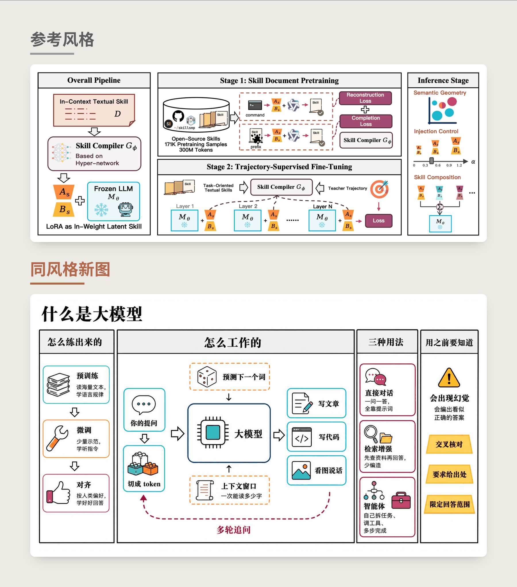
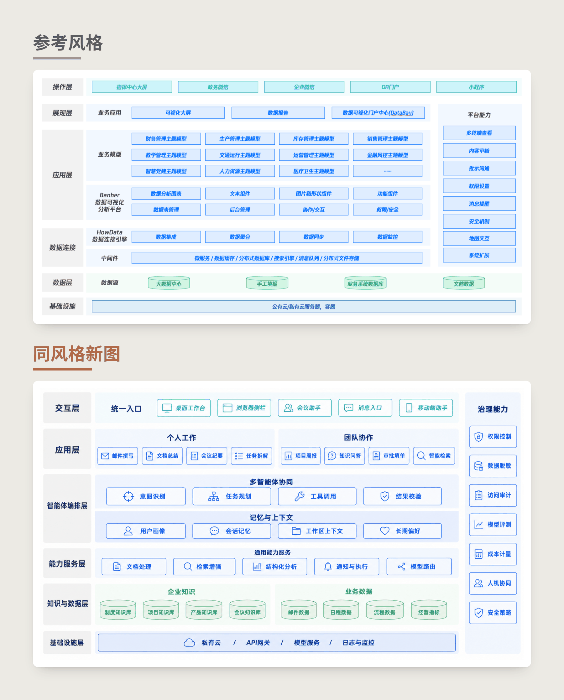
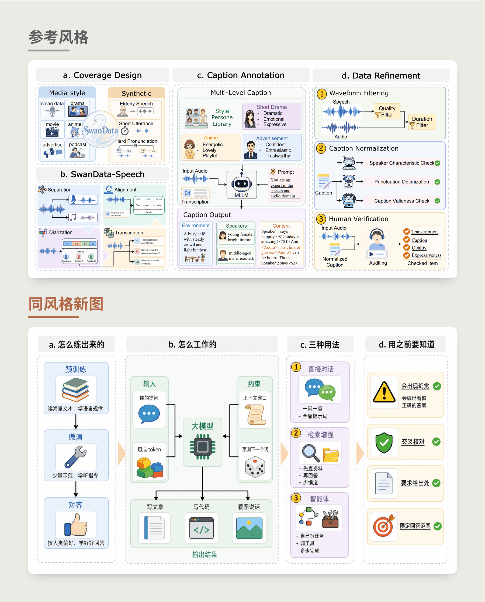
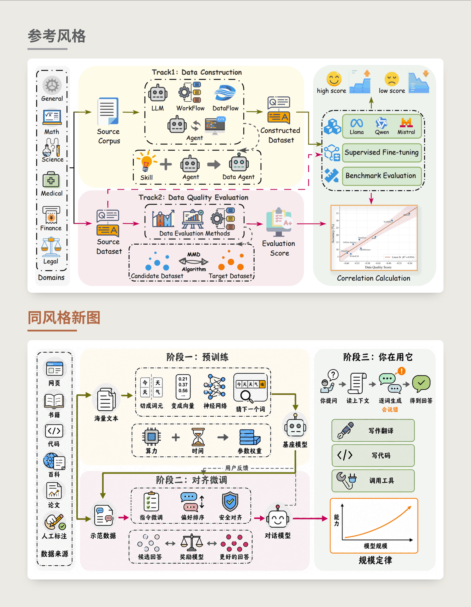
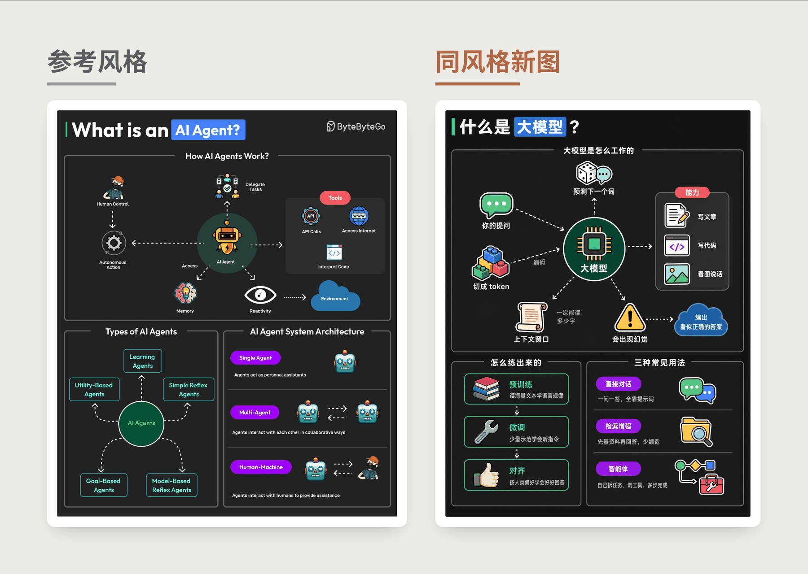
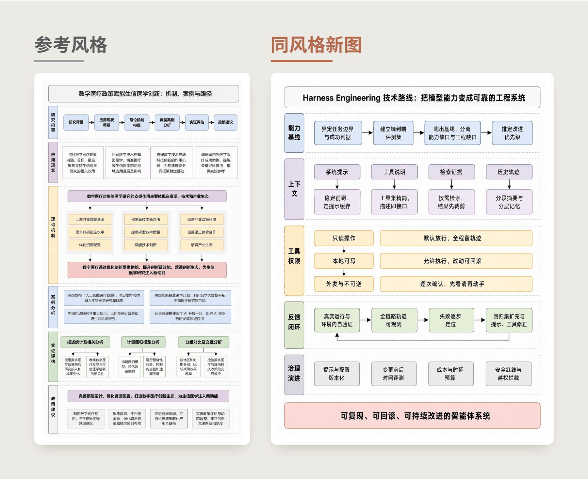

  

  

    
    
    
  

  

    <a href="#效果案例">效果案例</a> ·
    <a href="#安装">安装</a> ·
    <a href="#直接开始">直接开始</a> ·
    <a href="#工作方式">工作方式</a> ·
    <a href="#style-library">Style Library</a>
  

---

## 这是什么

FigEcho（图易现）是一个面向技术图的 AI Agent Skill。它从参考图中提炼可迁移的视觉系统，再把新的技术内容组织成同一视觉家族的图。

技术图的风格不只是配色。信息如何分区、容器如何嵌套、箭头如何组织、字体如何分级、图标如何统一，以及高信息密度下如何保持秩序，都会决定一张图的辨识度。FigEcho 把这些可观察特征整理为视觉指纹，并编译成一份脱离原图语境也能直接使用的中文分模块提示词。

你可以只拿走提示词，也可以让它先规划新内容的图示结构，再把参考图与完整提示词一起送进图片模型出图。喜欢的风格还能保存为 Style Pack，连同原始参考图进入本地风格库，以后按名字或用途检索复用。

如果你也在使用 FigEdit · 图易编，可以把二者看成一组前后衔接的工具：FigEcho 负责让新图长成目标视觉家族，FigEdit 负责把已有位图重建为可编辑图形。

## 效果案例

每组图片都包含参考图与新生成图。两张图的内容不同，但共享同一套布局、组件、线条、配色、字体与图标语言。

### 案例一：英文论文方法图 → 中文大模型科普图

保留非对称宽度节奏、粗黑宏观边界、浅灰标题带三级容器、粗黑实线配白心三角箭头；文字、图标题材、分区数量和阅读路径全部按新内容重排。风格包 [`black-frame-serif-architecture`](./style-library/templates/black-frame-serif-architecture/) · 黑框衬线架构图。

### 案例二：数据可视化平台架构 → 企业智能体平台架构

保留最左灰底层名列贯通、右侧独立纵向支撑栏、1px 细描边等宽方阵、全图不画箭头不画连线；层级命名、每层条目、右栏内容和青蓝绿的层语义分段全部按新内容重算。风格包 [`gray-column-layered-architecture`](./style-library/templates/gray-column-layered-architecture/) · 层带灰名列架构图。

### 案例三：论文方法总览图 → 大模型科普图

保留四级容器嵌套、一个模块一个色相的淡彩填充、纯黑细实线直角三角箭头、外松内紧的密度节奏；模块划分、图标题材、色相与内容的对应关系全部重新派生。风格包 [`macaron-nested-method-figure`](./style-library/templates/macaron-nested-method-figure/) · 马卡龙套盒方法图。参考图 © SwanData-Speech。

### 案例四：双轨数据方法图 → 大模型训练流程图

保留三层嵌套容器、手写感圆头漫画体、单一高饱和色的粗直角折线主链路、图标背后垫浅灰圆盘；主轨内容与走向、图标题材、左中右三段的宽度比例按新内容重排。风格包 [`playful-cartoon-schematic`](./style-library/templates/playful-cartoon-schematic/) · 俏皮卡通手绘示意图。

### 案例五：英文暗底信息图 → 中文暗底科普图

保留深炭黑底配圆角面板、标题骑在面板顶边缺口、白色虚线箭头作唯一连接语言、扁平贴纸图标配下置短标签；文字、图标题材、面板划分、四色霓虹强调色的语义映射全部更换。风格包 [`charcoal-dashed-node-explainer`](./style-library/templates/charcoal-dashed-node-explainer/) · 炭黑虚线节点科普图。参考图 © ByteByteGo。

### 案例六：课题技术路线图 → 工程技术路线图

保留竖向行带堆叠、左窄标签块配右通栏内容区、浅灰虚线外框套浅彩描边卡片、黑色细直角箭头；行带数量与命名、每行条目、按行带切换的色系分段全部重排。风格包 [`research-proposal-roadmap`](./style-library/templates/research-proposal-roadmap/) · 科研申报总体路线图。

> 案例中的参考图属于第三方作品，仅用于风格分析与对照，版权归原作者。详见 [style-library/NOTICE.md](./style-library/NOTICE.md)。

## 安装

安装到当前项目：

    npx skills add giszzt/FigEcho --skill figecho --copy --yes

安装为全局 Skill：

    npx skills add giszzt/FigEcho --skill figecho --copy --yes --global

从源码运行：

    git clone https://github.com/giszzt/FigEcho.git
    cd FigEcho
    python -m unittest discover -s tests -p "test_*.py"

需要 Python 3.10 或更高版本。只抽取风格与生成提示词时不需要 API Key；只有在 Agent 没有内置图像工具、又要求直接出图时，才需要配置第三方图片后端。

## 直接开始

- “提取这张技术路线图的布局、图标、线框、配色和字体，给我一份可复用的风格提示词。”
- “分析这组三张论文示意图，找出它们共同的视觉语法。”
- “参考这张架构图的风格，把下面的模块关系画成一张新图。”
- “先把这段研究内容规划成合适的图示结构，再生成同风格技术图。”
- “把刚才的风格保存为‘马卡龙三级科研框架’，以后继续复用。”
- “列出风格库里适合高密度技术路线图的模板。”
- “做一张产品分层架构图，风格你从库里挑。”

当用户既没有提供参考图，也没有点名模板时，FigEcho 会先检索 Style Library 并列出候选；确实没有匹配项时，再请用户选择补充参考图或确认创建原创风格。它不会在没有确认的情况下自行虚构风格来源。

## 交付模式

| 用户真正需要的结果 | 默认交付 |
|---|---|
| 抽取风格、复刻风格提示词 | 一份完整、自包含的分模块提示词 |
| 风格分析、视觉规范、结构拆解 | 简洁风格结论 + 完整提示词 |
| 直接画图、生成同风格新图 | 最终 PNG + 实际送入模型的完整提示词 |

提示词默认包含图像类型、内容结构、整体版式、组件语言、连接线、插图与图标、配色、字体层级、视觉气质、关键风格特征和生成约束。内部规划与校验文件只在用户明确需要时提供。

## 工作方式

1. **确定风格来源**：解析用户点名的 Style Pack，或读取本轮参考图；两者都没有时先检索风格库并取得用户确认。
2. **提取视觉指纹**：从布局、组件、连接线、配色、字体、图标、表面质感与密度中提炼 5–7 个高辨识度锚点，并记录证据、权重与迁移规则。
3. **编译统一提示词**：把稳定视觉语法写成完整的中文分模块提示词，把源图专有内容替换为可适配规则。
4. **规划新内容**：把用户材料整理为节点、分组、关系与信息层级，再选择图型、画幅、阅读路径和视觉编码。
5. **生成同风格新图**：以风格提示词为唯一母版填入新内容，同时把原始参考图作为真实图片输入送进模型。
6. **用证据验收**：先检查画幅、配色和密度，再逐个风格锚点记录可见证据、偏差与分数；通过后才能晋级为 validated Style Pack。

## 核心设计

### 视觉指纹不是配色摘要

风格相似性必须来自多个维度的组合。FigEcho 不把“科技感”“简洁”“高级”当作视觉规范，也不会只抄一组颜色后套进通用卡片模板。

### 新内容决定结构

参考图提供视觉语言，新内容决定语义拓扑。栏数、节点数、阅读路径、图标题材和强调色语义都会按新内容重算，避免把源图的业务结构机械复制到新图。

### Prompt 保持单一谱系

`style-prompt.md` 是唯一的风格约束源。成图时的 `prompt.md` 由它填入内容与图示规划生成，不另写一份简化英文摘要，因此最终交付的提示词与实际生成调用保持一致。

### 验证区分“画得像”与“能迁移”

rendered validation 检查一次真实成图是否体现了风格锚点；portability validation 则要求在不同主题下重新规划拓扑、派生图标题材、重映射色彩语义，并确认没有源内容残留。两者分别记录，不能互相替代。

## Style Library

每个 Style Pack 包含命名信息、别名、适用场景、完整提示词、视觉指纹、原始参考图和验证记录。模板先以 candidate 保存，通过真实成图检查后成为 validated；完成跨主题迁移测试后，`portability_status` 才能变为 passed。

仓库内附带 6 个示例 Style Pack。`preview.png` 只用于浏览，真正复用时仍会同时加载原始参考图与完整 Prompt。

    python scripts/style_library.py list
    python scripts/style_library.py search "高密度 科研"
    python scripts/style_library.py show macaron-nested-method-figure
    python scripts/style_library.py add --job-dir ./figecho-job --name "马卡龙三级科研框架" --slug pastel-nested-research-framework --alias "淡彩科研框架"
    python scripts/style_library.py validate

Style Library 默认位于 Skill 包内。可通过 `FIGECHO_LIBRARY` 指向独立的持久化目录，避免升级或重新安装 Skill 时遗漏个人模板。

## 图像后端与配置

成图模式共用同一份 `prompt.md` 与同一套验收标准：

- Agent 自带可接收参考图的图像工具时优先使用内置工具；
- 没有内置工具时，`scripts/generate_figure.py` 可依次尝试 Labnana GPT-Image-2、Nano Banana、OpenAI 官方、Gemini 官方或自定义命令。

先检查当前可用路线：

    python scripts/generate_figure.py --precheck

第三方后端配置写在 `.env` 或环境变量中，真实密钥不会进入任务记录与版本库。复制 [`env.example`](./env.example) 后按需填写即可。参考图含内部、敏感或个人信息时，应先确认所选图像服务是否适合接收这些内容。

## 项目结构

    FigEcho/
    ├── SKILL.md               # Agent 工作流入口
    ├── references/            # 视觉语法、规划、提示词与质量规范
    ├── scripts/               # 任务初始化、出图、校验与风格库工具
    ├── style-library/         # 示例 Style Pack 与目录索引
    ├── tests/                 # 单元测试与文档一致性测试
    ├── evals/                 # 触发与输出评估样例
    ├── agents/                # Agent UI 与兼容性元数据
    └── assets/                # 品牌图与案例图

## 开发与验证

    python -m unittest discover -s tests -p "test_*.py"
    python scripts/style_library.py validate
    python scripts/generate_figure.py --precheck

完整排错信息放在 [docs/troubleshooting.md](./docs/troubleshooting.md)，README 只保留首次使用所需的主路径。

## 边界与许可

FigEcho 迁移的是布局语法、组件规则、色彩关系、字体类别、图标抽象度与表面质感，不迁移源图文字、Logo、人物身份、数据、版权标记、水印或其他专有内容。它不用于像素级复制、去水印或冒充原作。

代码与文档采用 MIT License。风格库中的第三方参考图不在 MIT 授权范围内，版权仍归原作者；来源与移除说明见 [style-library/NOTICE.md](./style-library/NOTICE.md)。

## 致谢

- OpenAI bundled imagegen：图像生成、参考图角色与定向迭代方法。
- [OpenClaw diagram-maker](https://github.com/openclaw/openclaw/tree/main/skills/diagram-maker)：内容节点、分组与关系的结构化方法。

## Author

[giszzt](https://github.com/giszzt) · Jisai / 极思狂想

## License

MIT。Copyright (c) 2026 giszzt / Jisai / 极思狂想。详见 [LICENSE](./LICENSE)。
